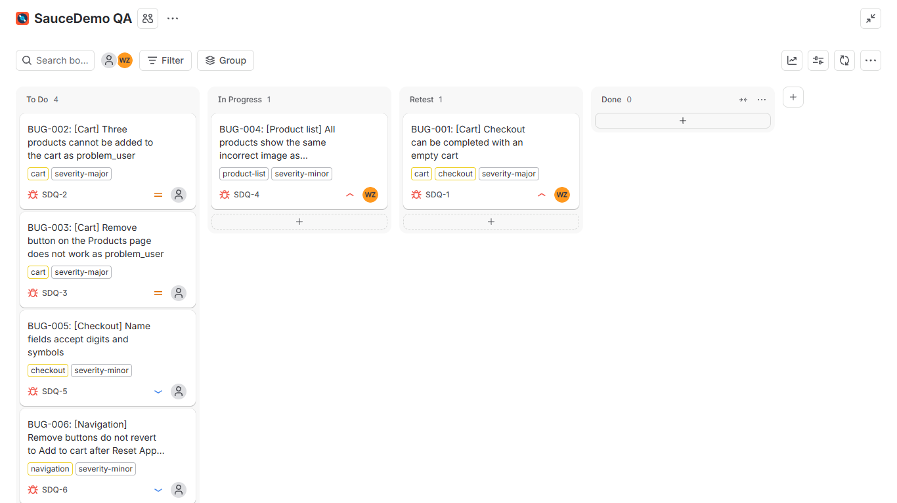

# saucedemo-qa-testing

Manual QA project for the SauceDemo e-commerce site (https://www.saucedemo.com): a test plan, 56 designed test cases (smoke, negative, boundary) and documented defects.

**Status:** Complete. All 56 test cases executed: 52 passed, 4 failed. 6 defects logged.

## What's inside

| Folder | Contents |
|---|---|
| [`docs/`](docs) | [Test plan](docs/TEST_PLAN.md) |
| [`test-cases/`](test-cases) | [Test cases and execution results](test-cases/saucedemo-test-cases.xlsx) |
| [`bug-reports/`](bug-reports) | One markdown file per defect |
| [`evidences/`](evidences) | Screenshots supporting the bug reports and the Jira board |

## Scope

- Login and logout, product list and sorting, cart, checkout, and menu/footer navigation. See the test plan for what is out of scope.
- The problem_user account is a demo account built to exhibit defects, and was used for exploratory testing.

## Results

| Module | Test cases | Executed | Passed | Failed |
|---|---|---|---|---|
| Login | 15 | 15 | 15 | 0 |
| Product list | 10 | 10 | 10 | 0 |
| Cart | 12 | 12 | 10 | 2 |
| Checkout | 14 | 14 | 13 | 1 |
| Navigation | 5 | 5 | 4 | 1 |
| **Total** | **56** | **56** | **52** | **4** |

The smoke suite (9 cases) has been executed, and all 9 passed.

## Smoke test cases

The 9 smoke cases, run first on every build. Full results for all 56 cases are in [test-cases/saucedemo-test-cases.xlsx](test-cases/saucedemo-test-cases.xlsx) (also available as [CSV](test-cases/saucedemo-test-cases.csv)).

| ID | Module | Test case | Expected result | Status |
|---|---|---|---|---|
| TC-LOGIN-001 | Login | Login with valid credentials | Products page opens | Pass |
| TC-LOGIN-002 | Login | Login fails with wrong password | Error says username and password do not match; user stays on Login page | Pass |
| TC-LOGIN-014 | Login | Direct URL access without login | Redirected to login with an error saying login is required | Pass |
| TC-LOGIN-015 | Login | Logout returns to Login page | Login page shown; Back does not reopen the Products page | Pass |
| TC-PROD-001 | Product list | Product list loads after login | 6 products shown, each with image, name, description, price and Add to cart button | Pass |
| TC-PROD-004 | Product list | Sort Price (low to high) | Prices ascend from $7.99 to $49.99 | Pass |
| TC-PROD-009 | Product list | Add to cart button changes state | Button changes to Remove; cart badge shows 1 | Pass |
| TC-CART-001 | Cart | Added item appears in cart with correct details | Cart shows the item, quantity 1, with correct name, description and price; badge shows 1 | Pass |
| TC-CHKOUT-001 | Checkout | Complete a purchase with valid details | Order confirmation page shows 'Thank you for your order!' | Pass |

## Defects logged

| ID | Summary | Severity | Priority |
|---|---|---|---|
| [BUG-001](bug-reports/BUG-001.md) | Checkout can be completed with an empty cart | Major | High |
| [BUG-002](bug-reports/BUG-002.md) | Three products cannot be added to the cart as problem_user | Major | Medium |
| [BUG-003](bug-reports/BUG-003.md) | Remove button on the Products page does not work as problem_user | Major | Medium |
| [BUG-004](bug-reports/BUG-004.md) | All products show the same incorrect image as problem_user | Minor | High |
| [BUG-005](bug-reports/BUG-005.md) | Name fields accept digits and symbols | Minor | Low |
| [BUG-006](bug-reports/BUG-006.md) | Remove buttons do not revert to Add to cart after Reset App State | Minor | Low |

Four defects came from failed test cases (BUG-001, 002, 005 and 006). BUG-003 and BUG-004 were found by exploratory testing with problem_user.

Defects are also tracked in Jira (project: SauceDemo QA).

BUG-001 (Retest) and BUG-004 (In Progress) were moved only to demonstrate the workflow. SauceDemo is a demo site, so no fixes are expected and all six defects remain open.

## Approach

- **Techniques:** black-box testing (equivalence partitioning and boundary value analysis on the login and checkout forms) and experience-based testing (error guessing and exploratory testing)
- **Test types:** smoke, functional, negative, boundary, exploratory
- **Process:** run the smoke suite first, execute the remaining cases module by module, log each defect with steps and evidence, then summarize results

## Tools

Git and GitHub · VS Code · Chrome DevTools · Jira (bug tracking) · Microsoft Excel / Google Sheets

## Next

Automation: the smoke cases are automated with Playwright and JavaScript in [saucedemo-playwright-automation](https://github.com/DellZaragosa/saucedemo-playwright-automation), with each test linked back to its manual case ID. Regression cases are next.

## Author

Wendell Zaragosa