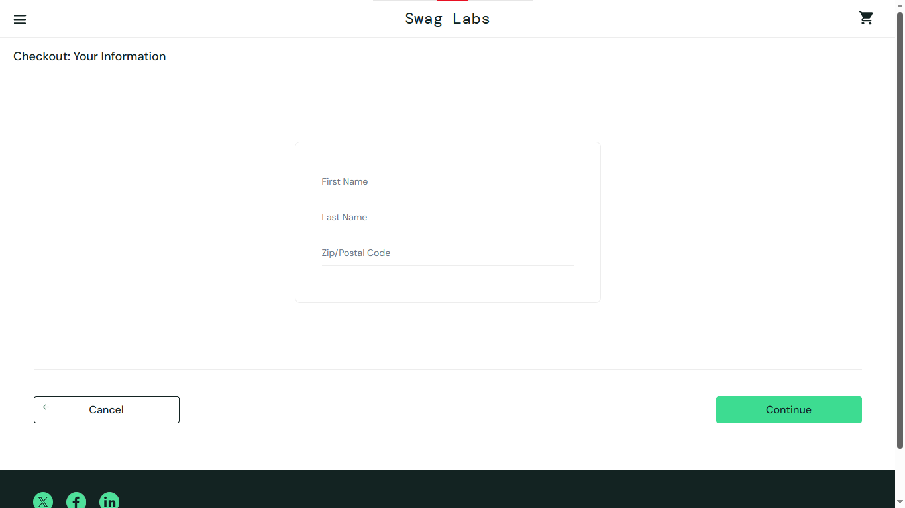
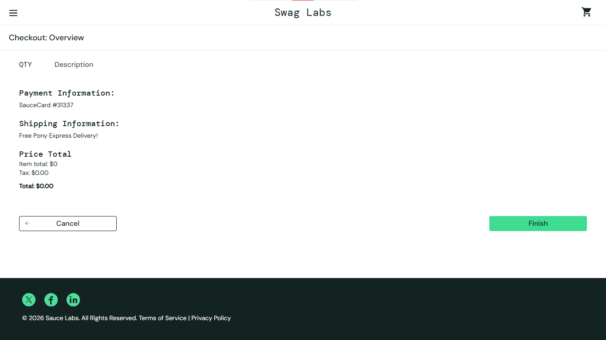
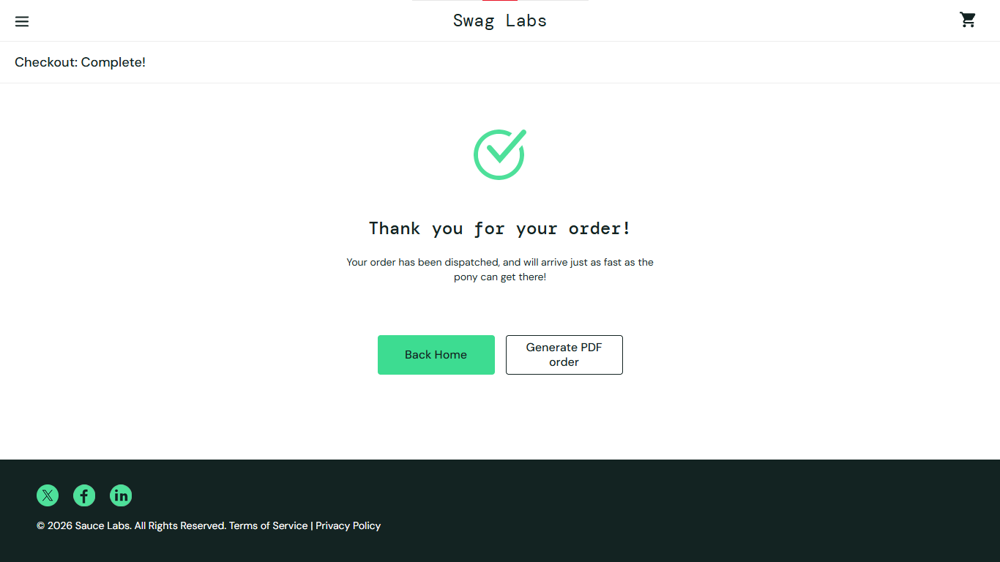

# BUG-001: [Cart] Checkout can be completed with an empty cart

| Field | Value |
|---|---|
| **Status** | New |
| **Severity** | Major |
| **Priority** | High |
| **Reported by** | Wendell Zaragosa |
| **Date reported** | 2026-11-14 |
| **Related test case** | TC-CART-010 |

## Environment
- Browser: Chrome 157.0.8103.51
- OS: Windows 10
- URL: https://www.saucedemo.com
- Account: standard_user

## Preconditions
Logged in as standard_user. The cart is empty and no badge shows on the cart icon.

## Steps to reproduce
1. Click the cart icon to open the empty cart.
2. Click **Checkout**.
3. Enter a first name, last name and postal code, then click **Continue**.
4. Click **Finish** on the overview page.

## Expected result
Checkout is blocked, or the user is warned that the cart is empty, so an order cannot be placed with no items.

## Actual result
Checkout proceeds and the user can complete the checkout process with no items. The overview page lists no items and shows Item total: $0, Tax: $0.00 and Total: $0.00. After clicking Finish, the "Checkout: Complete!" page is shown with the message "Thank you for your order!".

## Frequency
Reproducible 3 out of 3 attempts.

## Evidence

## Notes
- A user can place an order that contains no products, which breaks the basic purchase rule.
- A normal purchase with items in the cart works (TC-CHKOUT-001 passed), so the problem is specific to an empty cart.