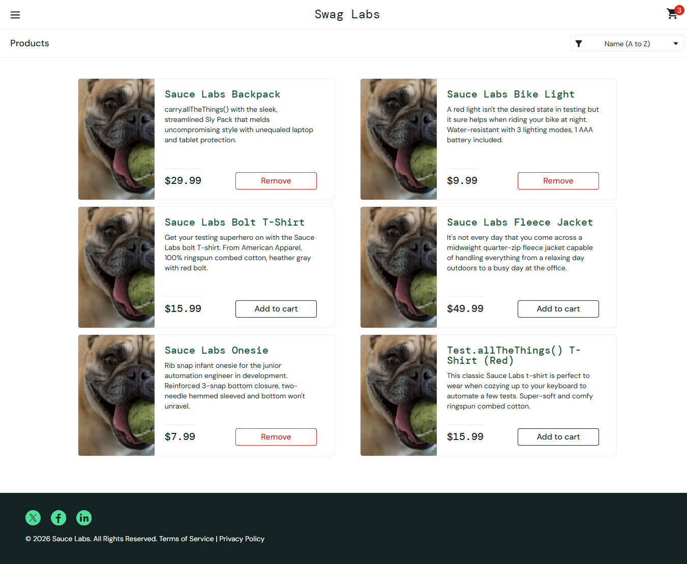
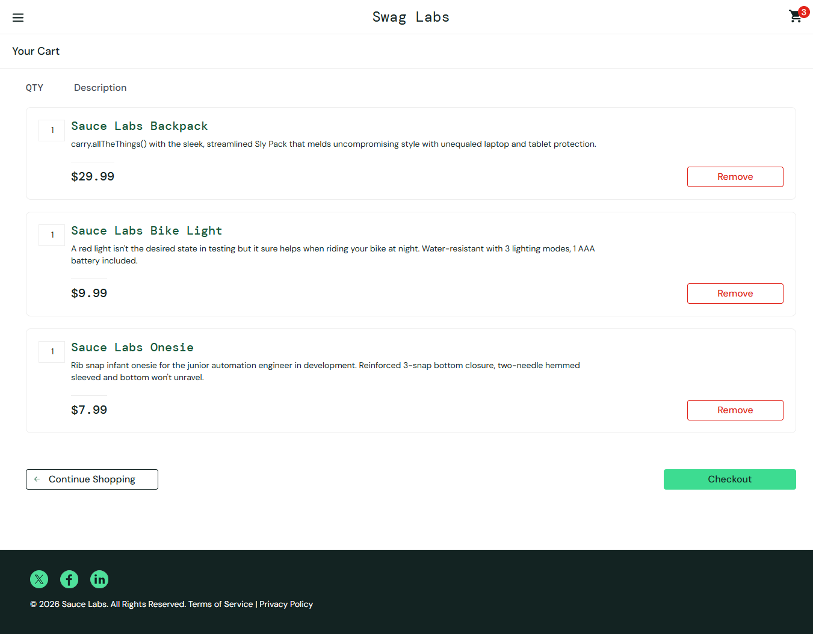

# BUG-002: [Cart] Three products cannot be added to the cart as problem_user

| Field | Value |
|---|---|
| **Status** | New |
| **Severity** | Major |
| **Priority** | Medium |
| **Reported by** | Wendell Zaragosa |
| **Date reported** | 2026-11-15 |
| **Related test case** | TC-CART-012 |

## Environment
- Browser: Chrome 157.0.8103.51
- OS: Windows 10
- URL: https://www.saucedemo.com
- Account: problem_user

## Preconditions
Not logged in; the cart is empty.

## Steps to reproduce
1. Log in as `problem_user` with password `secret_sauce`.
2. On the Products page, click **Add to cart** on each of the six products: Sauce Labs Backpack, Bike Light, Bolt T-Shirt, Fleece Jacket, Onesie and Test.allTheThings() T-Shirt (Red).
3. Open the cart.

## Expected result
All six products are added: each button changes to **Remove**, the cart badge shows 6, and six items appear in the cart.

## Actual result
Only Sauce Labs Backpack, Bike Light and Onesie are added, and their buttons change to **Remove**. For Bolt T-Shirt, Fleece Jacket and Test.allTheThings() T-Shirt (Red), nothing happens after the click and the button stays as **Add to cart**. The cart badge shows 3 and the cart lists 3 items.

## Frequency
Reproducible 3 out of 3 attempts.

## Evidence

## Notes
- Not observed with standard_user.
- problem_user is a demo account built to show defects, and was used for exploratory testing.