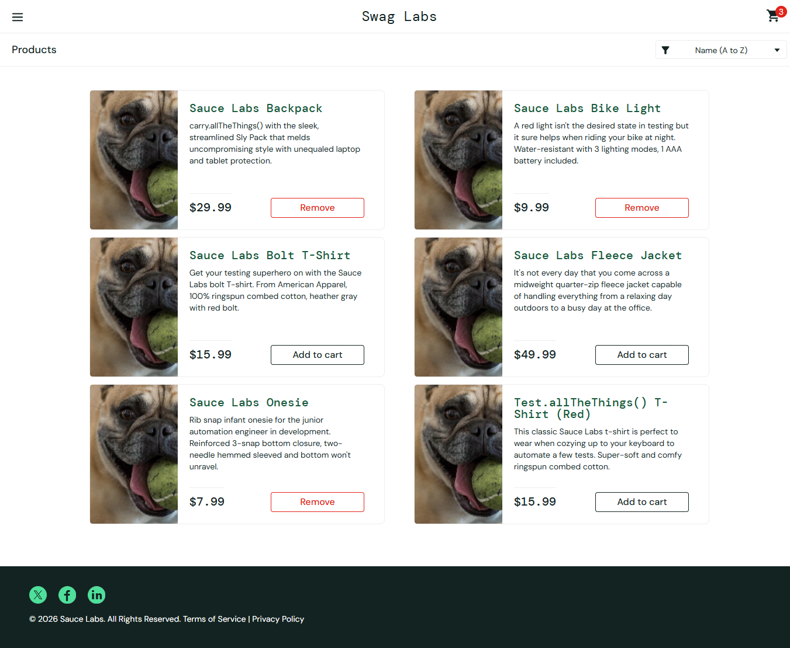
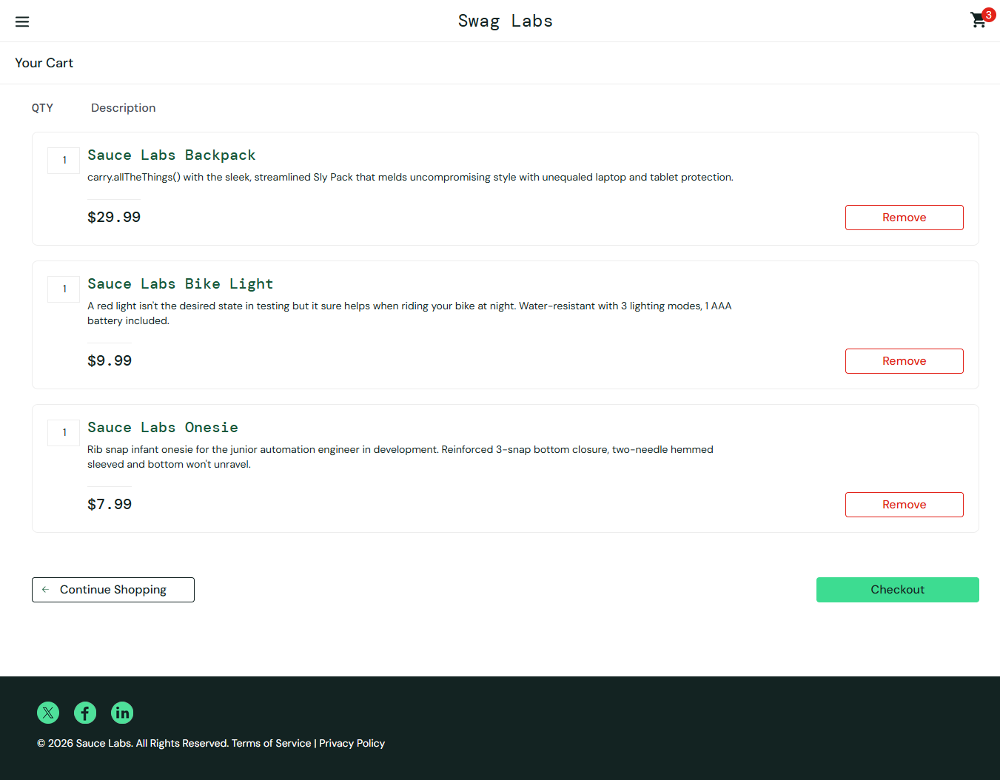

# BUG-003: [Cart] Remove button on the Products page does not work as problem_user

| Field | Value |
|---|---|
| **Status** | New |
| **Severity** | Major |
| **Priority** | Medium |
| **Reported by** | Wendell Zaragosa |
| **Date reported** | 2026-11-16 |

## Environment
- Browser: Chrome 157.0.8103.51
- OS: Windows 10
- URL: https://www.saucedemo.com
- Account: problem_user

## Preconditions
The user is not logged in and the cart is empty.

## Steps to reproduce
1. Log in as `problem_user` with password `secret_sauce`.
2. On the Products page, click **Add to cart** on Sauce Labs Backpack, Bike Light and Onesie. The three buttons change to **Remove**.
3. Click **Remove** on each of the three products.
4. Open the cart.

## Expected result
Each item is removed from the cart, its button changes back to **Add to cart**, the cart badge decreases, and the cart no longer lists the items.

## Actual result
Clicking **Remove** on the Products page has no effect. The buttons stay as **Remove** and do not change back to **Add to cart**. The cart badge still shows 3 and all three items are still listed in the cart.

## Frequency
Reproducible 3 out of 3 attempts.

## Evidence

## Notes
- Found by exploratory testing in the same session as TC-CART-012, using problem_user.
- Removing the item on the cart page works, so a workaround exists.
- TC-CART-004 (Remove on the Products page) passes with standard_user, so the problem is specific to problem_user.