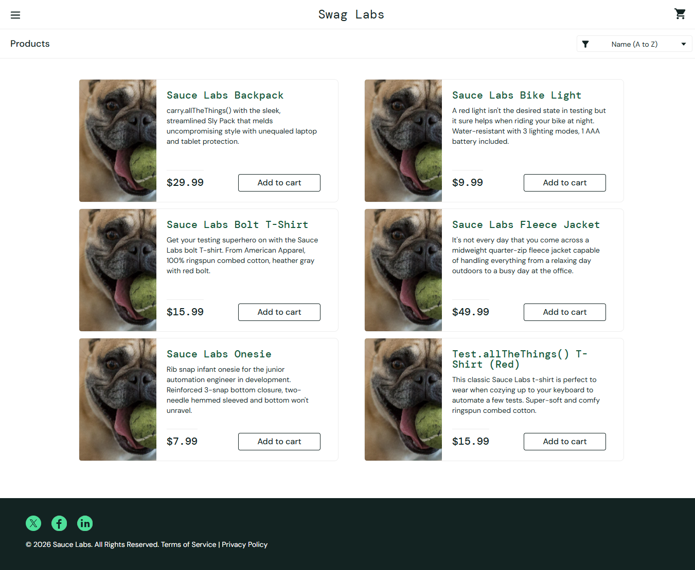

# BUG-004: [Product list] All products show the same incorrect image as problem_user

| Field | Value |
|---|---|
| **Status** | New |
| **Severity** | Minor |
| **Priority** | High |
| **Reported by** | Wendell Zaragosa |
| **Date reported** | 2026-11-16 |

## Environment
- Browser: Chrome 157.0.8103.51
- OS: Windows 10
- URL: https://www.saucedemo.com
- Account: problem_user

## Preconditions
The user is not logged in.

## Steps to reproduce
1. Log in as `problem_user` with password `secret_sauce`.
2. Look at the product images on the Products page.

## Expected result
Each product shows its own image, matching its name.

## Actual result
All six products show the same image (a photo of a dog) that does not match any product name.

## Frequency
Reproducible 3 out of 3 attempts.

## Evidence

## Notes
- Product names, descriptions and prices are displayed correctly. Only the images are wrong.
- The images are correct with standard_user, so the problem is specific to problem_user.