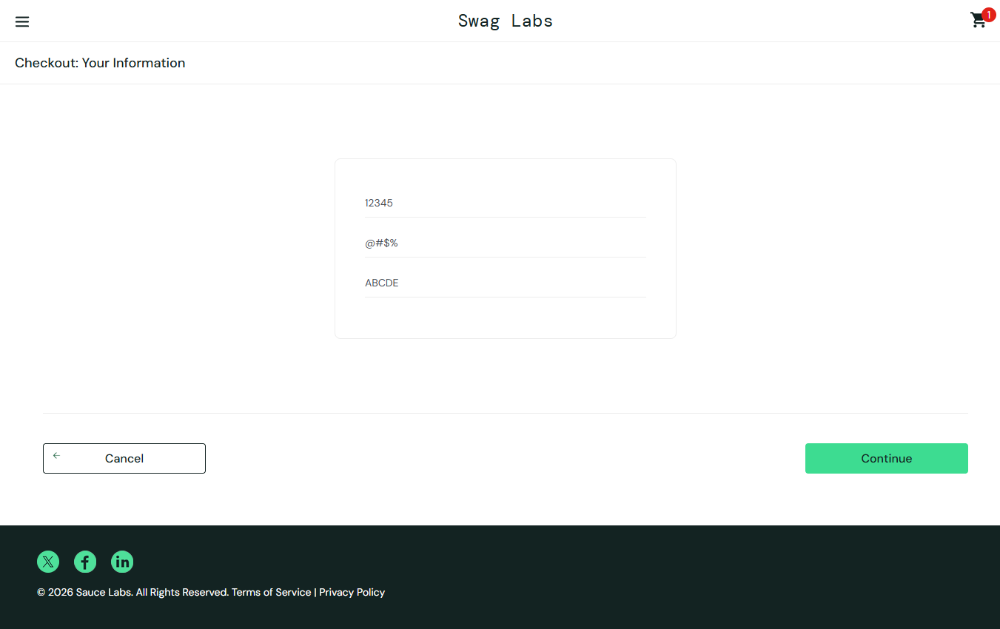
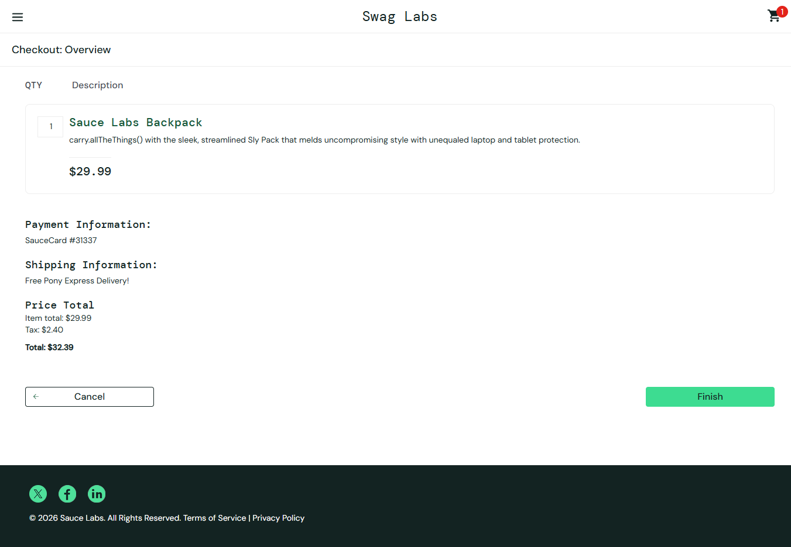

# BUG-005: [Checkout] Name fields accept digits and symbols

| Field | Value |
|---|---|
| **Status** | New |
| **Severity** | Minor |
| **Priority** | Low |
| **Reported by** | Wendell Zaragosa |
| **Date reported** | 2026-11-18 |
| **Related test case** | TC-CHKOUT-013 |

## Environment
- Browser: Chrome 157.0.8103.51
- OS: Windows 10
- URL: https://www.saucedemo.com
- Account: standard_user

## Preconditions
The user is logged in as standard_user and the cart contains one item.

## Steps to reproduce
1. Open the cart and click **Checkout**.
2. Enter `12345` as the first name, `@#$%` as the last name and `ABCDE` as the postal code.
3. Click **Continue**.

## Expected result
The first and last name fields accept letters only. Digits and symbols are rejected with an error message, and the user stays on the information page.

## Actual result
The values are accepted and the checkout overview page opens. No validation message is shown for the first name or the last name.

## Frequency
Reproducible 3 out of 3 attempts.

## Evidence

Fields from top to bottom: first name, last name, postal code.

## Notes
- No validation rules are documented for these fields, so the expected result is a judgment: a realistic name contains letters only, with no digits or symbols.
- Letters in the postal code are not reported as a defect, since postal codes in some countries contain letters.