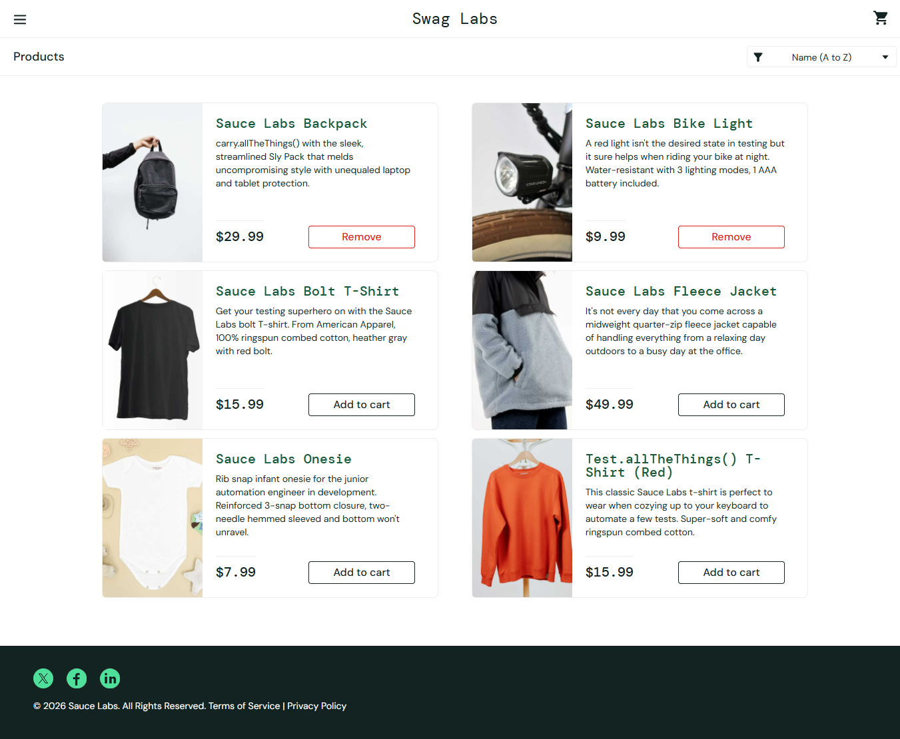

# BUG-006: [Navigation] Remove buttons do not revert to Add to cart after Reset App State

| Field | Value |
|---|---|
| **Status** | New |
| **Severity** | Minor |
| **Priority** | Low |
| **Reported by** | Wendell Zaragosa |
| **Date reported** | 2026-11-19 |
| **Related test case** | TC-NAV-003 |

## Environment
- Browser: Chrome 157.0.8103.51
- OS: Windows 10
- URL: https://www.saucedemo.com
- Account: standard_user

## Preconditions
The user is logged in as standard_user and the cart is empty.

## Steps to reproduce
1. On the Products page, click **Add to cart** on two products. Both buttons change to **Remove**.
2. Open the menu and click **Reset App State**.
3. Look at the cart badge and the buttons on the Products page.

## Expected result
The cart is emptied, the badge disappears, and the buttons change back to **Add to cart**.

## Actual result
The badge disappears and the cart is empty, but the two buttons still show **Remove**.

## Frequency
Reproducible 3 out of 3 attempts.

## Evidence

## Notes
- The buttons show Remove for items that are no longer in the cart, which can confuse a user.
- After refreshing the page, the buttons change back to Add to cart.